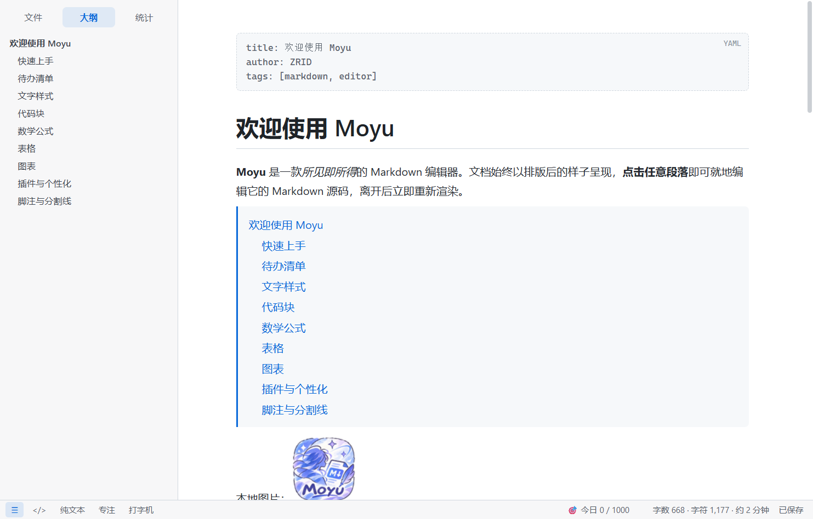
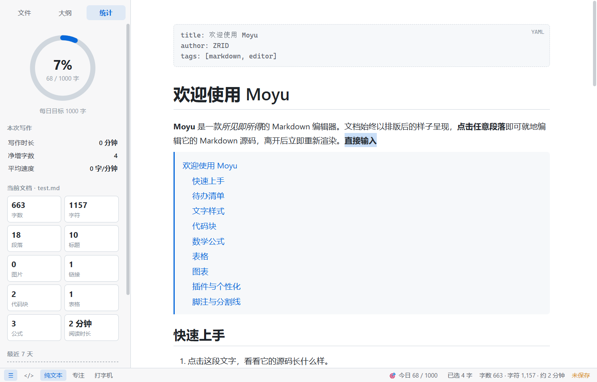
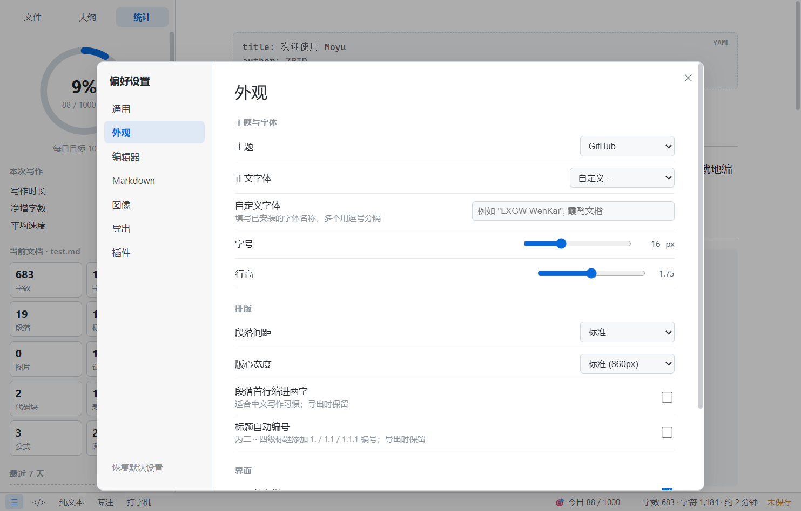

# Moyu —— 所见即所得的 Markdown 编辑器

<p align="center">
  
</p>

<p align="center">
  <a href="https://github.com/Eterna10/Moyu/releases"></a>
  <a href="LICENSE"></a>
  
  
</p>

Moyu 是一款功能对标 Typora 的桌面 Markdown 编辑器：文档始终以排版后的样子呈现，点击任意段落即可就地编辑其源码，离开后立即重新渲染。完全离线运行。



---

## 快速上手与下载

### 1. 下载预编译版本

你可以在 [GitHub Releases](https://github.com/Eterna10/Moyu/releases) 页面下载最新构建版本：

| 版本 | 文件名 | 说明 |
| --- | --- | --- |
| **安装版（推荐）** | `Moyu-Setup-1.5.0.exe` | 中文安装向导，可自定义安装路径，自动创建桌面与开始菜单快捷方式，关联 `.md` / `.markdown` 打开方式，可在系统设置中卸载 |
| **便携版** | `Moyu-1.5.0-Portable.exe` | 单文件免安装，解压即可运行，随身携带（首次启动解压稍需几秒） |

> **提示**：安装包暂未购买商业代码签名证书，首次运行时 Windows SmartScreen 可能提示「未知发布者」，点击「更多信息 → 仍要运行」即可。设置与插件数据保存在 `%APPDATA%\Moyu`，卸载时保留。

### 2. 源码运行与开发者模式

如果你想从源码运行或参与开发：

```bash
# 1. 克隆仓库
git clone https://github.com/Eterna10/Moyu.git
cd Moyu

# 2. 安装依赖
npm install

# 3. 启动开发模式（或双击运行 启动Moyu.bat）
npm start
```

### 3. 构建与自检命令

```bash
npm test        # 端到端自动化自检（键鼠事件驱动，输出截图与报告到 test-output/）
npm run pack    # 生成免安装目录版 dist/Moyu-win32-x64/
npm run dist    # 打包并生成安装版与便携版至 dist/release/
```

---

## 界面展示

| 夜间主题 | 公式实时预览 |
| :---: | :---: |
|  |  |

| 纯文本排版编辑 | 偏好设置 |
| :---: | :---: |
|  |  |

---

## 主要功能

### 📝 编辑体验
- **块级实时渲染**：点击段落即可进入就地编辑，光标精确跟随；编辑区支持语法高亮，标题依据层级自适应显示。
- **实时效果预览**：数学公式、Mermaid 图表、表格、HTML、图片在编辑时下方提供毫秒级实时渲染预览。
- **智能回车机制**：段落自然拆分；有序/无序列表、任务列表、引用自动续行，空行连续回车退出；表格回车自动插入新行、Tab 键便捷跳格；代码块（` ``` `）与公式块（`$$`）自动补全闭合符号。
- **全键盘流畅流转**：支持 ↑ ↓ ← → 跨块无缝移动，Tab / Shift+Tab 调整列表缩进，退格键智能合并上一段落。
- **纯文本模式（F7，默认开启）**：编辑时直接在排版结果上修改，不显现 Markdown 标记字符；段落、标题、列表、引用、表格、代码块均支持。编辑前自动进行「渲染 → 还原 → 再渲染」双向一致性校验，若无法完全无损则自动平滑降级至源码模式，保证文本安全。
- **源代码模式（Ctrl+/）**：随时一键切换全文档源码，两种模式间光标精确互映射。
- **剪贴板管理**：复制粘贴或拖曳本地/截图图片自动保存至文档对应同级 `assets/` 目录。

### 🖼️ 图像管理（深度对标 Typora）
- **插入图片规则**：支持无特殊操作 / 自动复制到当前文件夹 / 自动复制到 `./assets` / 复制到自定义路径（支持 `${filename}` 变量）/ **自动上传至图床**。
- **图床上传集成**：
  - **PicGo (app)**：无缝调用 PicGo 本地服务接口（`127.0.0.1:36677`），未启动时可自动拉起应用。
  - **PicGo-Core**：支持直接通过命令行调用核心组件上传。
  - **自定义脚本/命令**：支持灵活配置外部上传 CLI。
- **上传容灾机制**：「验证图片上传选项」一键测试连通性；遇到网络异常或图床故障时自动回退为本地路径，绝不丢失文档图片。
- **批量管理**：提供菜单项「格式 → 图片 → 上传所有本地图片」，一键扫描并替换文档内的全部本地引用为云端链接。

### 🧩 插件扩展系统（API v1）
- **轻量易扩展**：单个插件目录即为一个独立扩展（包含 `plugin.json` 与 `main.js`），支持放置于内置 `plugins/` 或用户全局目录 `%APPDATA%\Moyu\plugins`。
- **能力开放**：
  - 扩展 Markdown 语法规则（基于 markdown-it 管道、自定义围栏代码块渲染器、前后处理钩子）。
  - 注册自定义快捷键与菜单命令（自动集成至「插件」主菜单）。
  - 注入状态栏小组件与侧边栏专属面板。
  - 监听核心事件周期（打开、修改、保存、主题切换，支持在 `onWillSave` 阶段改写内容）。
- **沙箱隔离与热载**：单插件运行时异常完全隔离，不影响主编辑器稳定性；快捷键冲突自动检测提示；支持「插件 → 重新加载插件」热更新无需重启。
- **内置示例插件**：
  - **写作目标**（writing-goal）：每日字数目标规划、状态栏动态进度条、统计图表面板、历史打卡统计。
  - **提示块 Callout**（callout）：支持 GitHub 规范的 `> [!NOTE]`、`> [!TIP]`、`> [!WARNING]` 等美观提示框。
- 完整文档参见：[插件开发指南](docs/插件开发指南.md)。

### 📊 格式支持与导出
- **丰富语法**：GFM 表格、任务复选框、删除线、自动链接转换、代码高亮（190+ 编程语言）、KaTeX 数学公式渲染、Mermaid 流程图/时序图、脚注、`[TOC]` 自动大纲生成、YAML Front Matter、`==文本高亮==`、嵌入式原生 HTML。
- **导入与导出**：一键导出为排版优美的高保真 HTML（支持一键内嵌 Base64 图片离线自洽）与 PDF 文档（支持纸张尺寸 A4/A5、横向/纵向、边距与页眉页脚定制）。

### 🎨 偏好设置与个性化
- **外观主题**：内置 GitHub、Newsprint（报刊）、Night（夜间）、Midnight（午夜蓝）等精致主题。
- **全面定制**：支持调整正文字体（可加载系统任意字体）、字体大小、行高、段落间距、版心宽度、首行缩进、标题与公式自动编号等 60+ 细项设置。
- **视图模式**：大纲目录与阅读位置同步高亮、文件树导航、专注模式（F8）、打字机模式（F9）。

---

## 项目目录结构

```
Moyu/
├── .github/          GitHub 配置与工作流
├── build/            构建图标资源（icon.ico, icon.png, icon-source.webp）
├── docs/             项目文档与截图
│   ├── 插件开发指南.md
│   ├── 设计文档.md
│   └── screenshots/  界面预览截图
├── plugins/          内置示例插件（callout, writing-goal）
├── samples/          内置示例示例文档（欢迎文档、语法参考）
├── src/
│   ├── main/         Electron 主进程（窗口管理、菜单、IPC 通信、图片上传、插件机制）
│   ├── preload.js    安全桥接脚本（contextBridge 隔离）
│   └── renderer/     渲染进程（编辑器内核、排版渲染、UI 界面、快捷键）
├── test/             端到端自动化测试脚本（selftest.js）
├── tools/            打包构建工具与图标脚本
├── package.json      项目配置与依赖声明
├── LICENSE           开源许可证（MIT）
└── 启动Moyu.bat       Windows 开发模式快捷启动脚本
```

---

## 技术架构

- **核心运行环境**：Electron 45
- **解析与渲染引擎**：markdown-it · KaTeX · Mermaid · highlight.js · DOMPurify
- **安全架构**：渲染进程强制开启 `contextIsolation: true` 与 `sandbox: true`，所有外部内容及渲染产物均经 DOMPurify 净化防范 XSS。

---

## 许可证

本项目基于 [MIT 许可证](LICENSE) 开源。
