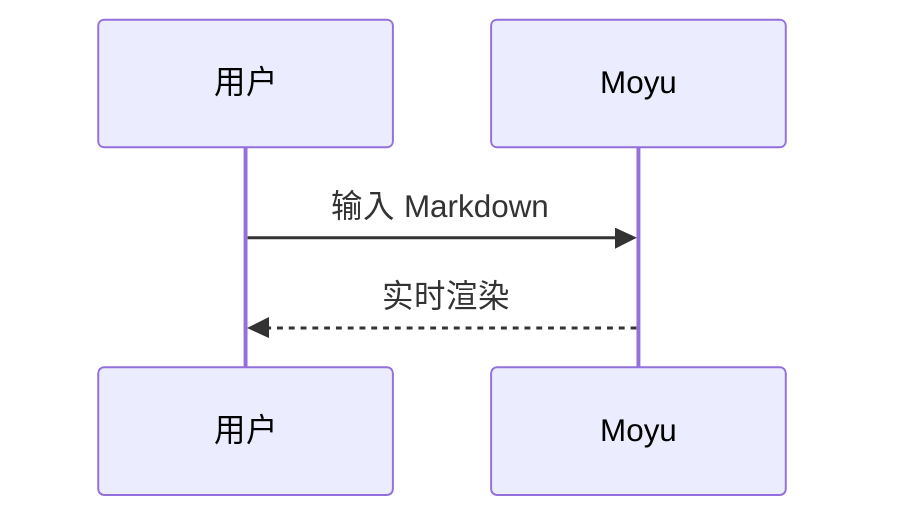

# Markdown 语法参考

## 标题

```markdown
# 一级标题
## 二级标题
### 三级标题
```

快捷键：`Ctrl+1` ~ `Ctrl+6`，`Ctrl+0` 恢复为段落。

## 强调

| 写法 | 效果 | 快捷键 |
| --- | --- | --- |
| `**加粗**` | **加粗** | Ctrl+B |
| `*斜体*` | *斜体* | Ctrl+I |
| `<u>下划线</u>` | <u>下划线</u> | Ctrl+U |
| `~~删除线~~` | ~~删除线~~ | Alt+Shift+5 |
| `==高亮==` | ==高亮== | Ctrl+Shift+H |
| `` `代码` `` | `代码` | Ctrl+Shift+` |

## 列表

```markdown
- 无序列表
- 第二项
    - 嵌套（Tab 缩进，Shift+Tab 反缩进）

1. 有序列表
2. 第二项

- [ ] 任务列表
- [x] 已完成
```

- 无序列表
- 第二项
    - 嵌套

1. 有序列表
2. 第二项

- [ ] 任务列表
- [x] 已完成

## 引用

> 这是一段引用。
>
> > 引用可以嵌套。

## 链接与图片

```markdown
[链接文字](https://example.com "可选标题")

<https://自动链接.com>
```

图片可以直接**粘贴**或**拖入**编辑器，Moyu 会把它保存到文档旁边的 `assets` 目录。

## 代码

行内代码用一对反引号：`console.log()`。代码块用三个反引号并注明语言：

```python
def fib(n):
    a, b = 0, 1
    for _ in range(n):
        a, b = b, a + b
    return a
```

## 表格

```markdown
| 左对齐 | 居中 | 右对齐 |
| :--- | :---: | ---: |
| a | b | c |
```

| 左对齐 | 居中 | 右对齐 |
| :--- | :---: | ---: |
| a | b | c |

## 数学公式（KaTeX）

行内：`$a^2 + b^2 = c^2$` → $a^2 + b^2 = c^2$

块级：

$$
f(x) = \sum_{n=0}^{\infty} \frac{f^{(n)}(a)}{n!}(x-a)^n
$$

## 图表（Mermaid）



## 其它

* 分割线：`---`
* 目录：单独一行写 `[TOC]`
* 脚注：`正文[^1]`，在文末写 `[^1]: 脚注内容`
* YAML Front Matter：文档开头用 `---` 包裹的元数据
* HTML：可以直接书写 `<kbd>Ctrl</kbd>`、`<details>` 等标签 → <kbd>Ctrl</kbd>
