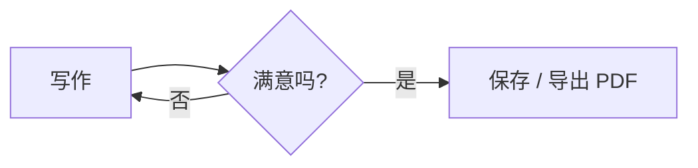

# 欢迎使用 Moyu

**Moyu** 是一款*所见即所得*的 Markdown 编辑器。文档始终以排版后的样子呈现，**点击任意段落**即可就地编辑它的 Markdown 源码，离开后立即重新渲染。

[TOC]

## 快速上手

1. 点击这段文字，看看它的源码长什么样。
2. 按 `Enter` 新建段落，`Shift+Enter` 在段落内换行。
3. 用 `↑` / `↓` 在段落之间移动，`Esc` 退出编辑。
4. 按 `Ctrl+/` 切换到**源代码模式**，再按一次切回来。

> 提示：在列表或引用中按 `Enter` 会自动续写；在空的列表项上再按一次 `Enter` 即可退出列表。

## 待办清单

- [x] 块级实时渲染
- [x] 代码高亮、数学公式、流程图
- [ ] 点击左边的复选框试试 ——它会直接修改源码
- [ ] 写下你的第一篇文档

## 文字样式

你可以写 **加粗**、*斜体*、<u>下划线</u>、~~删除线~~、==高亮==、`行内代码`，以及 [超链接](https://github.com)（按住 `Ctrl` 单击打开）。

## 代码块

```javascript
// 输入 ``` 加语言名后回车，会自动补全闭合围栏
function greet(name) {
  return `你好，${name}！`;
}
console.log(greet('Moyu'));
```

## 数学公式

行内公式：质能方程 $E = mc^2$，欧拉恒等式 $e^{i\pi} + 1 = 0$。

$$
\int_{-\infty}^{\infty} e^{-x^2}\,dx = \sqrt{\pi}
$$

## 表格

| 功能 | 快捷键 | 说明 |
| :--- | :---: | --- |
| 加粗 | `Ctrl+B` | 选中文字后使用 |
| 插入表格 | `Ctrl+T` | 表格内 `Tab` 跳到下一格 |
| 源代码模式 | `Ctrl+/` | 编辑整篇源码 |

## 图表



## 插件与个性化

> [!TIP] 试试插件
> 这个彩色的提示块由内置插件「提示块 Callout」渲染；状态栏里的 🎯 今日字数和侧边栏的「统计」页来自另一个插件「写作目标」。

- 菜单「插件」中可以运行插件命令；「帮助 → 插件开发指南」介绍了如何编写自己的插件。
- 「文件 → 偏好设置」（`Ctrl+,`）提供 60 多项设置：字体、段落间距、标题编号、回车键行为、图片上传、PDF 纸张等。

## 脚注与分割线

Moyu 支持脚注[^1]，也支持分割线：

---

更多语法见菜单「帮助 → Markdown 语法参考」，快捷键见「帮助 → 快捷键一览」。祝写作愉快！

[^1]: 这是一个脚注，会显示在文档末尾。
